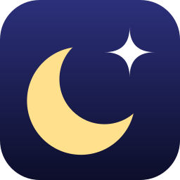

<p align="center"></p>

# Nightglass

Nightglass is a small Windows tray app that sets NASA's [Astronomy Picture of the Day](https://science.nasa.gov/apod/) (APOD) as your desktop wallpaper, every day, on every monitor. It was formerly called **APOD Wallpaper**.

- **The monitor with the most pixels** gets the latest picture; **every other monitor** gets the one before it.
- **Full resolution:** downloads NASA's original image, not the resized preview.
- **Never cropped or stretched:** the picture is centered at full height, and the bars beside it are filled with colors taken from the picture's own edges, so they blend in.
- **Video days** are skipped. If today's APOD is a video, the most recent still picture is used instead.
- Starts at login and checks for a new picture every 3 hours (every 5 minutes after a failure).

## Tray menu

Right-click the tray icon:

| Item | What it does |
|------|--------------|
| **Nightglass vX.Y.Z** | Shows the version you're running (greyed out) |
| **Update available: vX.Y.Z** | Appears only when a newer release exists; opens its download page |
| **Refresh now** | Check NASA and re-apply the wallpapers immediately |
| **Open today's APOD page** | Opens science.nasa.gov/apod in your browser |
| **Bar style → Soft blend** | Bars fade gently; sharp features like a horizon blur into a smooth gradient (default) |
| **Bar style → Crisp follow** | Bars track the picture's edge closely, keeping features like the horizon sharper |
| **Quit** | Exit the app |

Hovering over the icon shows "Nightglass:" and the latest picture's title.

## Download

Get `nightglass-amd64.exe` (or `nightglass-arm64.exe` for Windows on ARM) from the [latest release](https://github.com/derekslenk/nightglass/releases/latest).

Put it in `%LOCALAPPDATA%\Programs\Nightglass\` (paste that into File Explorer's address bar and create the folder), then run it from there. Don't run it from Downloads: the app starts itself at login from wherever it was first run, so it stops working if that copy is cleaned up.

The exe isn't code-signed, so the first time, Windows SmartScreen may warn about an unknown publisher: choose **More info → Run anyway**.

**To update:** when the tray menu shows **Update available**, download the new exe, right-click the tray icon → **Quit**, replace the exe in that folder (keep the same file name), and run it again.

**Coming from APOD Wallpaper?** Quit it, put `nightglass-amd64.exe` in the folder above, and run it. On first run it takes over the old startup entry and moves your settings and downloaded pictures from `%LOCALAPPDATA%\APOD\`. Then delete the old `apod-wallpaper.exe`. The old app's update check doesn't recognize the renamed project, so it won't announce this release.

## Requirements

- Windows 10 or 11
- [Go](https://go.dev/) 1.27+, only to build from source (e.g. `mise use go@latest`)

No NASA API key is needed.

## Build from source

```sh
go build -ldflags "-H windowsgui -s -w" -o nightglass.exe .
./nightglass.exe
```

`-H windowsgui` keeps a console window from opening. On first run the app registers itself to start at login (per-user, no admin needed). If you move the `.exe`, run it once from the new location and the startup entry updates itself.

Only one copy runs at a time; launching it again does nothing.

## Files

Everything lives in `%LOCALAPPDATA%\Nightglass\`:

| Path | Contents |
|------|----------|
| `YYYY-MM-DD.jpg` / `.png` | Downloaded originals (the newest 7 are kept) |
| `rendered\` | Wallpapers rendered at each monitor's exact resolution |
| `settings.json` | Your bar style choice |
| `nightglass.log` | Activity and errors |

## How it works

1. **Fetch:** reads the official APOD RSS feed at `science.nasa.gov/feed/apod-basic/`. The older `api.nasa.gov` APOD API broke when APOD moved to science.nasa.gov in 2026 (it returns the NASA logo for every day), so it isn't used.
2. **Full resolution:** the feed's image links point to a preview capped at about 1280 px. The app rewrites `/dynamicimage/assets/…?w=…` to `/content/dam/…` to get the original.
3. **Monitors:** uses the Windows `IDesktopWallpaper` API to set a different wallpaper per monitor. "Largest" means the most pixels, so a short, wide strip display isn't mistaken for the main screen.
4. **Render:** each picture is scaled to fit and centered. For every row along the left and right edges, the app takes the median color of a thin strip (so stars don't count), smooths those colors along the edge, and paints the bars row by row. Panoramas wider than the screen get top and bottom bars instead.

## Troubleshooting

**All monitors show the same picture, or not an APOD at all.** Another wallpaper app is probably overriding this one. Microsoft Bing Wallpaper does this, and so can Wallpaper Engine and Lively. Quit it and disable its startup entry. The app logs a `WARNING` in `nightglass.log` when it sees one of these running.

**Nothing changes.** Check `nightglass.log`. Network failures are retried after 5 minutes.

## Uninstall

1. Right-click the tray icon → **Quit**.
2. Remove the `Nightglass` entry in **Settings → Apps → Startup** (or delete it from `HKCU\Software\Microsoft\Windows\CurrentVersion\Run`).
3. Delete `%LOCALAPPDATA%\Nightglass\` and the `.exe`.

## Development

```sh
go test ./...
go vet ./...
```

The rendering, feed parsing, monitor assignment and cleanup logic are plain Go with unit tests. Windows-specific code (COM wallpaper calls, tray, registry) is in the `*_windows.go` files and `main.go`.

The logo is drawn in code (`icon.go`), which also produces the tray icon. The exe's own icon comes from the committed `rsrc_windows_*.syso` files, which `go build` picks up automatically. If you change the logo, update `docs/logo.svg` and `docs/logo-256.png` to match, then regenerate the `.syso` files:

```sh
go run github.com/tc-hib/go-winres@v0.3.3 simply --icon docs/logo-256.png --arch amd64,arm64
```

Commit messages use the [Angular format](https://github.com/angular/angular/blob/main/contributing-docs/commit-message-guidelines.md). They drive releases: every push to `main` with a `fix:` commit publishes a patch release, `feat:` a minor release, and a `BREAKING CHANGE:` footer a major one. Pushes containing only `docs:`, `chore:`, `ci:`, `refactor:` or `test:` commits don't release anything.

## Credits

This is an unofficial app. It is not affiliated with or endorsed by NASA or Astronomy Picture of the Day.

Pictures and descriptions come from NASA's [Astronomy Picture of the Day](https://science.nasa.gov/apod/), by Robert Nemiroff and Jerry Bonnell. Many APOD images are copyrighted by their photographers, so check each image's credit before reusing it anywhere else.
